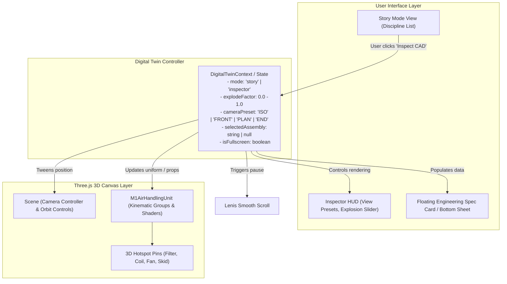

# Architecture Specification: Interactive 3D Digital Twin & Assembly Inspector

**Status:** Approved  
**Date:** 2026-11-02  
**Target:** Metavayn Web Platform — "What We Do" Section & 3D Canvas  
**Author:** Antigravity Engineering

---

## 1. Executive Summary & Goals

The Metavayn web platform features a 3D procedural Air Handling Unit (AHU-M1) built with Three.js, React Three Fiber, and GSAP. Currently, this unit operates primarily as a scroll-driven visual accent, rotating slightly and highlighting components in copper as the visitor scrolls through five disciplines.

This specification elevates the unit into a **professional-grade Interactive 3D Digital Twin & Assembly Inspector**. By offering an authentic CAD inspection experience directly on the Home Page, Metavayn provides undeniable proof of mechanical engineering rigor, manufacturing precision, and design-for-manufacturing (DFM) depth to enterprise clients, CTOs, and hardware founders.

### Key Success Criteria
1. **Zero Scroll Hijacking:** Default "Story Mode" scroll storytelling is preserved. Inspector Mode is an intentional, opt-in interactive state.
2. **Authentic Mechanical Rigor:** Features real engineering data (alloy grades, tolerances, EN/ISO/AWS standards) for 4 discrete sub-assemblies.
3. **Smooth Dual-Mode Lifecycle:** Fluid 0.4s entry and 0.3s exit between Story Mode and CAD Inspector Mode with Lenis scroll pausing.
4. **Fluid Multi-Axis Exploration:** Manual 0–100% explosion slider, 4 camera view presets (`ISO`, `FRONT`, `PLAN`, `END`), 3D orbit controls, and 3D hotspot callouts.
5. **Mobile-First Responsiveness:** Compact touch HUD and bottom-sheet drawer for spec inspection on viewports down to 360px.
6. **Performance & a11y:** Stable 60 fps rendering, keyboard accessible (`Esc`, `Tab`, `Arrow` keys), and complete reduced-motion support.

---

## 2. Architecture & State Management



### Digital Twin State Interface
```typescript
export type CameraPreset = "ISO" | "FRONT" | "PLAN" | "END";

export interface DigitalTwinState {
  mode: "story" | "inspector";
  explodeFactor: number; // 0.0 (assembled) to 1.0 (exploded)
  cameraPreset: CameraPreset;
  selectedAssemblyId: string | null;
  isFullscreen: boolean;
}
```

---

## 3. Sub-Assembly Data Model & Mechanical Specifications

The AHU-M1 modular unit is partitioned into four inspectable sub-assemblies with accurate engineering metadata:

```typescript
export interface SubAssemblyMetadata {
  id: "filter-bank" | "cooling-coil" | "centrifugal-fan" | "skid-base";
  num: string;
  name: string;
  discipline: string;
  hotspotAnchor: [number, number, number]; // [x, y, z] in local space
  materialSpecs: string;
  manufacturingProcess: string;
  designTolerances: string;
  validationStandard: string;
}

export const SUB_ASSEMBLIES: Record<string, SubAssemblyMetadata> = {
  "filter-bank": {
    id: "filter-bank",
    num: "01",
    name: "Air Intake & Filtration Module",
    discipline: "HVAC & Thermal Engineering",
    hotspotAnchor: [-1.4, 0.35, 0.65],
    materialSpecs: "1.6mm Galvanized Steel (GI) Casing, Synthetic Pre-Filters, MERV 14 Bag Filters",
    manufacturingProcess: "CNC Turret Punching, CNC Press-Brake Folding, Polyurethane Gasket Sealing",
    designTolerances: "±0.5 mm diagonal squareness, Air Leakage Class L1 compliant",
    validationStandard: "EN 1886:2007 (Mechanical Performance & Casing Strength)",
  },
  "cooling-coil": {
    id: "cooling-coil",
    num: "02",
    name: "Chilled Water Cooling Coil Section",
    discipline: "Mechanical Design Engineering",
    hotspotAnchor: [0.0, 0.25, 0.65],
    materialSpecs: "Seamless Copper Tubes (Ø12.7mm OD Cu-DHP), Corrugated Al Fins (14 FPI), SS304 Tray",
    manufacturingProcess: "Precision Mechanical Tube Expansion, CNC Hairpin Bending, Orbital TIG Welded Headers",
    designTolerances: "Fin spacing variance < 2%, Hydrostatic pressure tested to 2.5 MPa (360 psi)",
    validationStandard: "AHRI Standard 410 / ASME Boiler & Pressure Vessel Code Sec VIII",
  },
  "centrifugal-fan": {
    id: "centrifugal-fan",
    num: "03",
    name: "Centrifugal Blower & Drive Assembly",
    discipline: "Product Engineering",
    hotspotAnchor: [1.35, -0.05, 0.65],
    materialSpecs: "Backward-Curved DIDW Impeller, Laser-cut Scroll Housing, IE3 Motor, Cast Iron Bearings",
    manufacturingProcess: "Laser Profile Cutting, Dynamic Dual-Plane Balancing, Precision Shaft Turn-Grind",
    designTolerances: "Shaft radial runout < 0.02 mm, Vibration severity < 1.8 mm/s RMS at 1800 RPM",
    validationStandard: "AMCA 210 (Airflow & Static Efficiency) / ISO 1940 Grade G2.5",
  },
  "skid-base": {
    id: "skid-base",
    num: "04",
    name: "Structural C-Channel Foundation Skid",
    discipline: "Manufacturing Readiness",
    hotspotAnchor: [0.0, -0.68, 0.65],
    materialSpecs: "ISMC 100 Structural Steel C-Channels, Hot-Dip Galvanized (85µm minimum coating)",
    manufacturingProcess: "Full-Penetration Structural MIG Welding, Integrated Rigging/Lifting Lugs",
    designTolerances: "Diagonal camber tolerance < 2.0 mm over 4.0 m length, Deflection < L/500",
    validationStandard: "AWS D1.1 (Structural Welding Code - Steel) / ISO 1461",
  },
};
```

---

## 4. Kinematics & Camera Presets

### Explosion Kinematics
When `explodeFactor` expands from `0.0` to `1.0`:
- **Module 1 (Filter Bank):** Translates along X: $x = -1.15 - (\text{explodeFactor} \times 1.4)$.
- **Module 2 (Cooling Coil):** Remains centered: $x = 0.0$.
- **Module 3 (Fan & Blower):** Translates along X: $x = +1.15 + (\text{explodeFactor} \times 1.4)$.
- **Skid Base:** Drops along Y: $y = -0.70 - (\text{explodeFactor} \times 0.25)$ to provide clear clearance between base beams and modules.
- **Shadow:** Scales proportionally along X to ground the exploded geometry.

### Camera View Presets
The 3D Scene provides four instant projection presets:
1. **`ISO` (Isometric $30^\circ$ Projection):**
   - Position: `[4.8, 3.2, 4.8]`, Target: `[0, 0, 0]`
   - Purpose: Primary 3D spatial overview showing length, depth, and height simultaneously.
2. **`FRONT` (Elevation View):**
   - Position: `[0, 0, 6.4]`, Target: `[0, 0, 0]`
   - Purpose: Direct frontal inspection of door seams, copper manifolds, and module seams.
3. **`PLAN` (Top / Roof View):**
   - Position: `[0, 7.2, 0.01]`, Target: `[0, 0, 0]`
   - Purpose: Plant room layout review, duct discharge collar footprint, and structural skid layout.
4. **`END` (Profile View):**
   - Position: `[6.4, 0, 0]`, Target: `[0, 0, 0]`
   - Purpose: Intake louver inspection, fan outlet geometry, and cross-section dimensions.

---

## 5. User Interface & HUD Design

Following the Theme D2 Design Language, the HUD is minimalist, architectural, and high-contrast:

### Top Status Bar
- **Left:** `● LIVE CAD INSPECTION // AHU-M1 MODULAR DIGITAL TWIN` with subtle pulsing royal indicator.
- **Right:**
  - `[ ⛶ Fullscreen ]` button (toggles fullscreen canvas container).
  - `[ ✕ Resume Story ]` button (`border border-paper-line bg-paper text-black hover:bg-black hover:text-white`).

### Bottom Precision Dock
- **Camera Preset Strip:** Compact buttons for `[ ISO ]`, `[ FRONT ]`, `[ PLAN ]`, `[ END ]` with active royal border.
- **Explosion Scrubber:** Real-time draggable slider with percentage indicator and quick-action buttons:
  - `[ Assemble (0%) ]`
  - `[ Explode (100%) ]`

### Floating Engineering Spec Card (Desktop & Mobile)
- **Desktop:** Floats in the bottom-right corner of the canvas with generous padding.
- **Mobile (`< 768px`):** Slides up as a sleek bottom-sheet drawer with drag-down-to-dismiss handle.
- Displays:
  1. Component Number & Full Name
  2. Discipline Badge
  3. Material Specifications
  4. Fabrication & Assembly Processes
  5. Critical Quality & Tolerance Criteria
  6. Governing Standard

---

## 6. Mode Switching Lifecycle & Coordination

1. **Triggering Inspector Mode:**
   - User clicks `[ ⊕ Inspect CAD Digital Twin ]` or double-clicks the canvas.
   - Lenis smooth-scroll is paused (`lenis.stop()`).
   - GSAP animates HUD entrance (`opacity: 0 -> 1`, `duration: 0.4s`).
   - Camera smoothly transitions to `ISO` preset.
   - Initial `explodeFactor` eases to `0.50` to encourage immediate discovery.
2. **Exiting Inspector Mode:**
   - User clicks `[ ✕ Resume Story ]`, clicks outside, or presses `Escape`.
   - HUD fades out (`opacity: 1 -> 0`, `duration: 0.3s`).
   - Camera and explosion gap smoothly restore to the active discipline's scroll-tracked values.
   - Lenis smooth-scroll resumes (`lenis.start()`).

---

## 7. Performance & Accessibility Guarantees

- **Target 60 FPS:** Reuses static BufferGeometries and Three.js materials; zero garbage collection allocations in `useFrame`.
- **Keyboard Access (WCAG 2.1 AA):**
  - `Escape` key closes Inspector Mode.
  - `Tab` navigates through view preset buttons and hotspot pins with high-contrast `:focus-visible` rings.
  - `ArrowLeft` / `ArrowRight` increments/decrements explosion factor.
- **Reduced Motion (`prefers-reduced-motion`):**
  - Camera transitions switch instantly with duration 0.
  - Explosion factor applies without lerp lag.
  - HUD renders at full opacity immediately.

---

## 8. Verification & Test Plan

1. **Unit & Logic Tests:**
   - Verify explosion math coordinates for all 4 sub-assemblies.
   - Verify camera preset coordinate vectors.
2. **Playwright Visual & Interaction Verification:**
   - Test entry and exit transitions from Story Mode to Inspector Mode.
   - Test explosion slider drag from 0% to 100%.
   - Test all 4 camera presets (`ISO`, `FRONT`, `PLAN`, `END`).
   - Test hotspot pin clicks and verify spec card details for all 4 modules.
   - Test mobile viewport (375px) bottom-sheet drawer.
   - Record high-framerate verification video to `reports/motion-1/videos/digital-twin-inspector.webm`.
